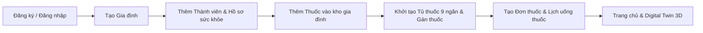

# PharmaMind AI — User Flow

## 1. Luồng Onboarding & Khởi tạo Gia đình

---

## 2. Luồng Uống thuốc Hằng ngày (Daily Medication Flow)

1. Người dùng mở **Trang chủ (Dashboard)** và thấy thẻ **Liều dùng tiếp theo (Next Dose Card)**.
2. Thẻ hiển thị rõ:
   - Giờ uống (`08:00` / `20:00`)
   - Tên thuốc & hàm lượng (`Paracetamol 500mg`)
   - Thành viên sử dụng (`Nguyễn Thị Lan`)
   - Ngăn tủ chứa thuốc (`Ngăn 1 — drawer_01`)
3. Người dùng bấm **"Mở ngăn tủ"** hoặc **"Xem trên tủ 3D"**:
   - Chuyển sang màn hình **Tủ thuốc (3D Digital Twin / Simple Mode)**.
   - Ngăn chứa thuốc sáng đèn / nhấp nháy vàng cam và trượt mở ra.
   - Panel thông tin bên phải hiển thị liều lượng, hướng dẫn dùng và cảnh báo dị ứng (nếu có).

---

## 3. Luồng Tương tác Tủ thuốc 3D (Digital Twin 3D Flow)

1. **Khởi tạo**:
   - Gọi `GET /families/{family_id}/cabinets/{cabinet_id}/digital-twin`.
   - Kết nối WebSocket `/ws/families/{family_id}/cabinets/{cabinet_id}?token=...`.
2. **Chọn ngăn (`drawer_01`..`drawer_09`)**:
   - Click trực tiếp lên ngăn 3D hoặc ô trong lưới 3×3.
   - Ngăn được highlight màu `#2E9C95`, InfoPanel cập nhật thông tin chi tiết.
3. **Mở / Đóng ngăn**:
   - Bấm **"Mở ngăn"** → gọi `POST /compartments/{position}/open`.
   - WebSocket phát sự kiện `COMPARTMENT_OPEN` → Ngăn 3D trượt ra theo trục Z (`+0.22m`) và hiển thị mô hình 3D viên thuốc / lọ thuốc bên trong.
   - Bấm **"Đóng ngăn"** → gọi `POST /compartments/{position}/close` → Ngăn 3D trượt đóng về vị trí gốc.

